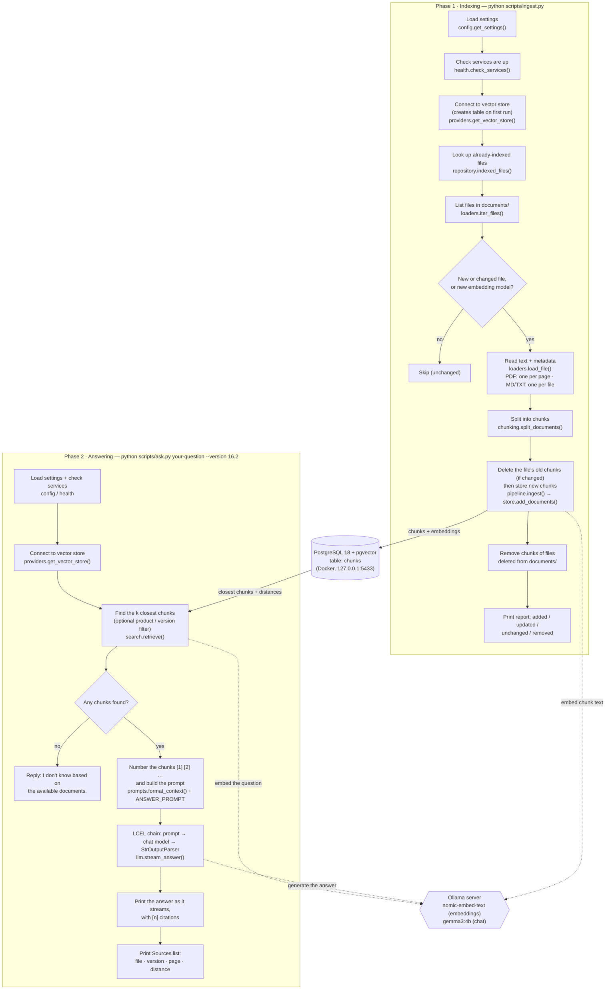

# RAG prototype: architecture and onboarding

A guide for developers new to this codebase: how a question becomes a cited answer, which file does what, and how to run it on your own machine.

> **Scope.** This describes the `poc/langchain-ollama` branch. It is a **local, command-line prototype**: two scripts, a PostgreSQL database in Docker, and models served by Ollama on your laptop. There is no web API, UI, user login or cloud deployment yet (see [Missing or incomplete parts](#11-missing-or-incomplete-parts)). Everything below is taken from the code on this branch.

---

## 1. The idea in one paragraph

RAG (retrieval-augmented generation) answers questions **from your own documents** instead of from what a language model memorised. It works in two phases:

1. **Indexing** (`scripts/ingest.py`): read every file in `documents/`, cut the text into small chunks, turn each chunk into an *embedding* (a list of 768 numbers that captures its meaning), and store chunk + embedding in PostgreSQL.
2. **Answering** (`scripts/ask.py`): turn the question into an embedding, find the stored chunks with the closest meaning, give those chunks to a chat model with strict instructions ("answer only from these passages and cite them"), and print the answer with its sources.

---

## 2. End-to-end flowchart

Solid arrows are the order of steps; dotted arrows are calls to the Ollama model server. Each box names the function and file that does the work.



---

## 3. Components and their files

| Component | Responsibility | Source file |
|---|---|---|
| **Settings** | Reads `.env` / environment variables, applies defaults, rejects bad values with a clear message | `src/rag/config.py` |
| **Service checks** | Before any work: is Ollama reachable, are the models installed, can we connect to the database? Prints one line per problem | `src/rag/health.py` |
| **Providers** | The **only** place that creates the chat model, the embedding model and the vector store. Everything else uses LangChain's standard interfaces, so backends can be swapped here | `src/rag/providers.py` |
| **Database helpers** | Opens PostgreSQL connections (10 s timeout), converts the URL for the async driver, checks the table exists, lists indexed files (with their fingerprint and embedding model) | `src/rag/database.py` |
| **Loaders** | Finds supported files and turns them into LangChain `Document`s with metadata from the folder path | `src/rag/ingestion/loaders.py` |
| **Chunking** | Splits each document into overlapping chunks that keep the metadata | `src/rag/ingestion/chunking.py` |
| **Ingestion pipeline** | Decides per file: add, replace, skip or remove; stores chunks | `src/rag/ingestion/pipeline.py` |
| **Retrieval** | Finds the closest chunks to a question, with optional product/version filter, and attaches each chunk's distance | `src/rag/retrieval/search.py` |
| **Prompt** | The instructions to the model and the numbered, labelled context | `src/rag/generation/prompts.py` |
| **Answer generation** | LCEL chain that sends the prompt to the chat model and returns plain text, whole or streamed | `src/rag/generation/llm.py` |
| **Indexing entry point** | Command-line script for phase 1 | `scripts/ingest.py` |
| **Answering entry point** | Command-line script for phase 2 | `scripts/ask.py` |
| **Local database** | PostgreSQL 18 with the pgvector extension, in Docker | `docker-compose.yml` |

---

## 4. Models, libraries and technologies by stage

| Stage | What is used | Notes |
|---|---|---|
| Configuration | `python-dotenv` | Values from real environment variables win over `.env` |
| Reading PDFs | `pypdf` (`PdfReader`) | Text-layer PDFs only; no OCR |
| Reading Markdown / text | Python standard library | UTF-8 |
| Document objects | `langchain-core` (`Document`) | Text + a metadata dictionary |
| Chunking | `langchain-text-splitters` (`RecursiveCharacterTextSplitter`) | 1000 characters, 150 overlap by default |
| Embeddings | `langchain-ollama` (`OllamaEmbeddings`) → Ollama → **`nomic-embed-text`** | 768 numbers per text |
| Vector database | **PostgreSQL 18 + pgvector 0.8** (Docker image `pgvector/pgvector:pg18`) | Cosine distance |
| Vector store API | `langchain-postgres` (`PGEngine`, `PGVectorStore`, the newer "v2" API) | Async driver `asyncpg`; our own table layout |
| Other database access | `psycopg` 3 | Table checks, listing indexed files, service checks |
| Prompt | `langchain-core` (`ChatPromptTemplate`) | System + human message |
| Chain | LangChain Expression Language (LCEL): `ANSWER_PROMPT \| chat_model \| StrOutputParser()` | Supports `.invoke()` and `.stream()` |
| Chat model | `langchain-ollama` (`ChatOllama`) → Ollama → **`gemma3:4b`** | Temperature 0 for consistent answers |
| Output | `langchain-core` (`StrOutputParser`) | Plain text; no structured/JSON output |
| Model server | **Ollama** (tested with 0.24) on `http://127.0.0.1:11434` | Runs on the CPU on a typical laptop |
| Tests | `pytest` | Unit tests use fakes; integration tests use real Docker + Ollama |

Tested with Python 3.14; `pyproject.toml` declares Python 3.10 or newer.

---

## 5. How a document is indexed (phase 1)

### 5.1 Where documents go

Files live in `documents/` (git-ignored, because they may be confidential). The folder path carries the metadata:

```
documents/<product>/<version>/<doc_type>/<file>
documents/documentum/16.2/release-notes/notes.pdf
           └ product  └ version └ doc_type
```

A file placed higher up still works; the missing levels are simply empty (`None`), which means version filtering cannot select it. Supported types: `.pdf`, `.md`, `.txt`. Hidden files and folders (starting with `.`) are ignored.

### 5.2 Load (`loaders.py`)

- `iter_files()` lists supported files in a stable (sorted) order.
- `load_file()` returns LangChain `Document`s:
  - **PDF:** one `Document` per page that has text, with `page` = page number (1, 2, …). Pages without a text layer (scans) are skipped.
  - **Markdown / text:** one `Document` for the whole file, `page` = `None`.
- Every `Document` carries this metadata (`file_metadata()`):

| Field | Example | Meaning |
|---|---|---|
| `source` | `documentum/16.2/release-notes/notes.pdf` | Path relative to `documents/` |
| `file_hash` | `fcbf630e…` (SHA-256) | Fingerprint of the file's bytes, used to skip unchanged files |
| `product` / `version` / `doc_type` | `documentum` / `16.2` / `release-notes` | From the folders |
| `page` | `3` or `None` | PDF page number |

### 5.3 Chunk (`chunking.py`)

`split_documents()` cuts each document into chunks of at most `CHUNK_SIZE` characters (default 1000) with `CHUNK_OVERLAP` characters (default 150) repeated between neighbours, so a sentence on a boundary is not lost. The splitter prefers paragraph breaks, then line breaks, then spaces. Each chunk keeps all of its document's metadata and gets a `chunk` number (0, 1, 2, … within that page or file).

### 5.4 Decide what to do with each file (`pipeline.py`)

`ingest()` compares each file with what is already stored (`repository.indexed_files()` returns, per `source`, its `file_hash` and `embedding_model`):

| Situation | Action | Reported as |
|---|---|---|
| Not stored yet | Load, chunk, store | Added |
| Stored, but the file's fingerprint or the embedding model changed | Delete its old chunks, then store the new ones | Updated |
| Stored, same fingerprint and same embedding model | Nothing (not even re-read) | Unchanged |
| Stored, but the file is no longer in `documents/` | Delete its chunks | Removed |
| File has no extractable text | Nothing stored | No text found |

Before storing, each chunk is tagged with `embedding_model` (e.g. `nomic-embed-text`).

### 5.5 Embed and store

There is **no separate embedding step in our code**: `store.add_documents(chunks)` (LangChain's `PGVectorStore`) sends each chunk's text to Ollama's `nomic-embed-text` model and writes text + embedding + metadata into PostgreSQL in one go.

### 5.6 The database table

`providers.get_vector_store()` creates the table the first time it runs (it embeds the phrase "dimension probe" once to learn the vector size, 768) and also enables the `vector` extension. Default table name: `chunks`.

| Column | Type | Content |
|---|---|---|
| `langchain_id` | UUID | Chunk id, generated automatically |
| `content` | text | The chunk's text |
| `embedding` | vector(768) | The chunk's embedding |
| `source`, `file_hash`, `product`, `version`, `doc_type`, `embedding_model` | text | Metadata as real columns, so filters are plain SQL |
| `page` | integer | PDF page number, empty for Markdown/text |
| `langchain_metadata` | JSON | All metadata, including `chunk` |

The column list is defined once, in `METADATA_COLUMNS` in `providers.py`. Changing it (or switching to an embedding model with a different vector size) requires dropping the table and re-indexing; for the local database, `docker compose down -v` wipes everything.

---

## 6. How a question is answered (phase 2)

### 6.1 Retrieve (`search.py`)

`retrieve(store, question, k=5, version=None, product=None)`:

1. The question is embedded with the same `nomic-embed-text` model (inside `PGVectorStore`).
2. PostgreSQL returns the `k` chunks with the smallest **cosine distance** to the question, optionally only those whose `version` and/or `product` match (both filters combined with AND).
3. Each returned chunk gets `metadata["distance"]`: 0 means the same meaning; larger means less related. On the sample data, relevant chunks scored about 0.26–0.49 and unrelated ones about 0.55–0.60. No cut-off is applied yet; all `k` chunks are passed on.

### 6.2 Build the prompt (`prompts.py`)

The retrieved chunks are numbered and labelled (`format_context()`), for example:

```
[1] (documentum/16.2/deprecated-features/list.pdf, version 16.2, page 3)
<chunk text>

[2] (documentum/16.2/release-notes/notes.md, version 16.2)
<chunk text>
```

`ANSWER_PROMPT` is a `ChatPromptTemplate` with two messages:

- **System:** answer using only the numbered passages; cite them like `[1]` or `[2][3]`; if they don't contain the answer, reply exactly *"I don't know based on the available documents."*; no outside knowledge; be concise.
- **Human:** `Context passages: … Question: …`

### 6.3 Generate (`llm.py`)

`answer_chain()` builds the LCEL chain:

```python
ANSWER_PROMPT | chat_model | StrOutputParser()
```

- `stream_answer()` (used by `ask.py`) yields the answer piece by piece as `gemma3:4b` writes it, so the text appears gradually.
- `answer()` returns the whole text at once, as an `Answer(text, sources)` (used by tests; available for a future API).
- If retrieval found **no chunks** (for example a version with no documents), both return the fixed "I don't know…" reply **without calling the model**.

### 6.4 Return the sources (`ask.py`)

After the answer, `ask.py` prints a **Sources** list: one line per retrieved chunk, numbered in the same order as in the prompt, so `[1]` in the answer matches `[1]` in the list:

```
Token authentication replaces basic authentication [1].

Sources:
  [1] acme-dms/1.0/deprecated-features/deprecated-features.md, version 1.0  (distance 0.346)
  [2] acme-dms/1.0/release-notes/release-notes.md, version 1.0  (distance 0.506)
```

The list is hidden when the answer is the "I don't know" reply. Note: it shows **every retrieved chunk**, not only the ones the model actually cited (here `[2]` was retrieved but not cited).

---

## 7. Configuration

Settings come from `.env` (copy `.env.example`) or from environment variables; real environment variables take precedence. All have defaults, so a copied `.env.example` works as-is locally.

| Variable | Default | Meaning |
|---|---|---|
| `LLM_PROVIDER` | `ollama` | Only `ollama` is supported |
| `LLM_MODEL` | `gemma3:4b` | Chat model name in Ollama |
| `EMBEDDING_PROVIDER` | `ollama` | Only `ollama` is supported |
| `EMBEDDING_MODEL` | `nomic-embed-text` | Embedding model name in Ollama |
| `OLLAMA_BASE_URL` | `http://127.0.0.1:11434` | Where Ollama listens |
| `CHUNK_SIZE` | `1000` | Maximum characters per chunk |
| `CHUNK_OVERLAP` | `150` | Characters repeated between neighbouring chunks (must be smaller than `CHUNK_SIZE`) |
| `DOCUMENTS_DIR` | `documents` | Folder that `ingest.py` reads (can also be passed with `--documents-dir`) |
| `VECTOR_STORE` | `pgvector` | Only `pgvector` is supported |
| `VECTOR_TABLE` | `chunks` | Table name (letters, digits and `_` only) |
| `DATABASE_URL` | none (required) | `.env.example` points it at the local Docker database: `postgresql://rag:…@127.0.0.1:5433/rag` |

> **Use `127.0.0.1`, not `localhost`,** in `DATABASE_URL` and `OLLAMA_BASE_URL`. On Windows, `localhost` tries IPv6 first: the database connection stalls and Ollama calls lose about 2 s each.

Command-line options of `ask.py`: `--version`, `--product` (filters) and `--k` (number of chunks to retrieve, default 5).

---

## 8. Dependencies

Declared in `pyproject.toml` (there is no `requirements.txt`):

| Group | Packages | Needed for |
|---|---|---|
| core | `python-dotenv`, `psycopg[binary]`, `langchain-core`, `langchain-text-splitters`, `pypdf` | Always |
| `ollama` | `langchain-ollama` | Ollama chat and embedding models |
| `pgvector` | `langchain-postgres`, `asyncpg` | PostgreSQL vector store |
| `dev` | `pytest` | Running tests |

External services: **Docker Desktop** (for the database) and **Ollama** with the two models pulled.

`langchain-community` is deliberately **not** used: it is being discontinued. PDFs are read with `pypdf` directly.

---

## 9. Running it locally (Windows)

**Prerequisites:** Python 3.10+ (tested on 3.14), Docker Desktop running, Ollama installed and running, Git.

For a step-by-step walkthrough in PowerShell that explains every command, see [run-locally-windows.md](run-locally-windows.md).

From the repository root, on branch `poc/langchain-ollama`:

```bash
# 1. Python environment and dependencies
python -m venv .venv
.venv/Scripts/python.exe -m pip install -e ".[ollama,pgvector,dev]"

# 2. Settings (the defaults work as-is)
cp .env.example .env

# 3. Database: PostgreSQL 18 + pgvector on 127.0.0.1:5433
docker compose up -d

# 4. Models
ollama pull gemma3:4b
ollama pull nomic-embed-text

# 5. Put files in documents/<product>/<version>/<doc_type>/, then index them
.venv/Scripts/python.exe scripts/ingest.py

# 6. Ask
.venv/Scripts/python.exe scripts/ask.py "Which features are deprecated?" --version 16.2
```

Re-run step 5 whenever files in `documents/` are added, changed or removed. Stop the database with `docker compose down` (data is kept); `docker compose down -v` deletes it.

**Expect slow answers on a laptop CPU:** about 15–40 seconds with `gemma3:4b`, and about a minute for the first question after Ollama starts (the model loads into memory).

### Tests

```bash
.venv/Scripts/python.exe -m pytest                     # unit tests: no services needed
.venv/Scripts/python.exe -m pytest -m integration      # live tests: need Docker database + Ollama
.venv/Scripts/python.exe -m pytest tests/unit/test_loaders.py::test_markdown_gives_one_document   # one test
```

Unit tests use stand-ins (a fake vector store, LangChain's `FakeListChatModel`, fake Ollama/database responses). Integration tests create and drop their own temporary tables, so your `chunks` table is not touched. Add `-p no:warnings` to hide a harmless deprecation warning from the `langsmith` package on Python 3.14.

### When something is not running

Both scripts check their services first and stop with one line, for example:

| Message starts with | Fix |
|---|---|
| `Can't reach Ollama at …` | Start Ollama, or check `OLLAMA_BASE_URL` |
| `Ollama model '…' is not installed` | Run the `ollama pull …` command shown |
| `Can't connect to the database at …` | Start Docker Desktop and run `docker compose up -d`, or fix the user/password in `DATABASE_URL` |
| `DATABASE_URL is not set` | Copy `.env.example` to `.env` |
| `Documents folder not found` (ingest only) | Create `documents/` or pass `--documents-dir` |

---

## 10. Project layout

```
RAG/
├── scripts/
│   ├── ingest.py            # Phase 1 entry point
│   └── ask.py               # Phase 2 entry point
├── src/rag/
│   ├── config.py            # settings
│   ├── health.py            # service checks
│   ├── providers.py         # chat model, embeddings, vector store (the only backend-specific code)
│   ├── database.py          # psycopg connections, URL helpers, table_exists, indexed_files
│   ├── ingestion/
│   │   ├── loaders.py       # files → Documents + metadata
│   │   ├── chunking.py      # Documents → chunks
│   │   └── pipeline.py      # add / update / skip / remove
│   ├── retrieval/
│   │   └── search.py        # retrieve() with filters + distance
│   └── generation/
│       ├── prompts.py       # ANSWER_PROMPT, format_context, source_label
│       └── llm.py           # LCEL chain, answer(), stream_answer()
├── tests/unit/              # fast tests with fakes
├── tests/integration/       # live tests (Docker + Ollama)
├── documents/               # your files (git-ignored)
├── docker-compose.yml       # local PostgreSQL + pgvector
├── pyproject.toml           # dependencies, pytest settings
├── .env.example             # settings template
└── CLAUDE.md                # notes for AI coding assistants
```

---

## 11. Missing or incomplete parts

**Not built:**

- **HTTP API:** only the two command-line scripts; `answer()` in `llm.py` is ready to be called from one.
- **Database migrations:** the `chunks` table is created by `providers.get_vector_store()`; there is no schema file or migration tool.
- **Reranking:** retrieved chunks are used in distance order as returned.
- **Providers:** only Ollama (models) and pgvector (storage); no Azure or other providers.
- **File types:** only PDF, Markdown and text. No Word, Excel, PowerPoint or HTML; no OCR for scanned PDFs.
- **Search:** vector search only. No keyword/full-text search, no relevance cut-off on distance, no vector index (every search compares against every chunk, which is fine at prototype size but will slow down with many documents).
- **Smarter chunking:** no splitting by Markdown headings; tables in PDFs come out as plain text in reading order.
- **Product features:** no mini document-management system (DMS), user interface, user accounts or permissions.
- **Deployment:** runs only on a developer machine; no server deployment.

**Known limitations and inconsistencies:**

- The **Sources** list shows all retrieved chunks, not only the ones the answer cites.
- The "I don't know" check in `ask.py` is a text match on the model's reply; if the model rephrases it, sources are still shown.
- No structured (JSON) output parsing: answers are plain text with `[n]` citations.
- The small `gemma3:4b` model can miss details spread over several passages.
- Each run spends roughly 1–9 s setting up the Ollama connection (the Ollama client library loads HTTPS certificates even for the local plain-HTTP address).
- The `integration` marker description in `pyproject.toml` still says "needs a remote database via SSH tunnel"; in practice the integration tests need the local Docker database and Ollama.
- `.env.example` mentions a remote PostgreSQL (through an SSH tunnel) as an alternative, but no remote database is set up for this app yet.
- The `documents/` folder convention assumes versioned product documentation; files outside it work but cannot be filtered by version.
