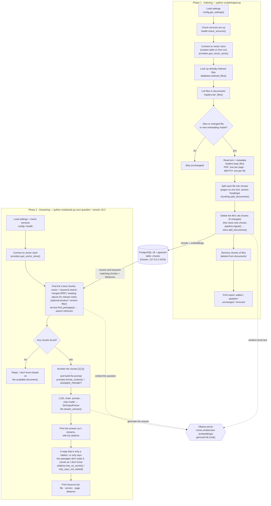

# RAG prototype: architecture and onboarding

A guide for developers new to this codebase: how a question becomes a cited answer, which file does what, and how to run it on your own machine.

> **Scope.** This describes the `integration` branch. It is a **local prototype**: two command-line scripts, a small HTTP API (FastAPI) over the same functions, a document library (upload, indexing status, open, download, delete), a React web app that uses the API, a PostgreSQL database in Docker, and models served by Ollama on your laptop. There is no user login or cloud deployment yet (see [Missing or incomplete parts](#12-missing-or-incomplete-parts)). This guide covers the backend in depth; the web app's screens are described in the [README](../README.md). Everything below is taken from the code on this branch.

---

## 1. The idea in one paragraph

RAG (retrieval-augmented generation) answers questions **from your own documents** instead of from what a language model memorised. It works in two phases:

1. **Indexing** (`scripts/ingest.py`): read every file in `documents/`, cut the text into small chunks, turn each chunk into an *embedding* (a list of 768 numbers that captures its meaning), and store chunk + embedding in PostgreSQL.
2. **Answering** (`scripts/ask.py`): turn the question into an embedding, find the stored chunks with the closest meaning, give those chunks to a chat model with strict instructions ("answer only from these passages and cite them"), and print the answer with its sources.

The HTTP API runs the same two phases for other programs, such as the web app: `POST /documents/ingest` and `POST /chat` (see [section 7](#7-http-api)). On top of indexing, a small **document library** lets people upload files into the documents folder, follows each file's indexing status, and serves or deletes the originals (see [section 7.6](#76-document-library)).

---

## 2. End-to-end flowchart

Solid arrows are the order of steps; dotted arrows are calls to the Ollama model server. Each box names the function and file that does the work. The scripts reach these steps through `service.py` (`build_services()`, `run_ingest()`); the HTTP API runs the same steps (section 7).



---

## 3. Components and their files

For a file-by-file walk through both workflows in call order, see [under-the-hood.md](under-the-hood.md).

| Component | Responsibility | Source file |
|---|---|---|
| **Settings** | Reads `.env` / environment variables, applies defaults, rejects bad values with a clear message | `src/rag/config.py` |
| **Service checks** | Before any work: is Ollama reachable, are the models installed, can we connect to the database? Prints one line per problem | `src/rag/health.py` |
| **Providers** | The **only** place that creates the chat model, the embedding model, the vector store (adding its full-text search column when hybrid search is on) and the keyword search. Everything else uses LangChain's standard interfaces, so backends can be swapped here | `src/rag/providers.py` |
| **Database helpers** | Opens PostgreSQL connections (10 s timeout), converts the URL for the async driver, checks the table exists, lists indexed files (with their fingerprint and embedding model), counts and deletes one file's chunks | `src/rag/database.py` |
| **Loaders** | Finds supported files and turns them into LangChain `Document`s with metadata from the folder path | `src/rag/ingestion/loaders.py` |
| **Chunking** | Splits each file (all its pages as one text) into overlapping chunks that keep the metadata of the page they start on, each prefixed with its numbered section headings | `src/rag/ingestion/chunking.py` |
| **Ingestion pipeline** | Decides per file: add, replace, skip or remove; stores chunks | `src/rag/ingestion/pipeline.py` |
| **Retrieval** | Finds the best chunks for a question by vector search, merged with keyword search (hybrid, on by default), with optional product/version filter, and attaches each chunk's distance; can keep places for a preferred document type (release notes) | `src/rag/retrieval/search.py` |
| **Keyword search** | PostgreSQL full-text search over the `chunks` table (generated `content_tsv` column, GIN index), ranked by how rare the matched words are; also returns each hit's cosine distance | `src/rag/retrieval/keyword.py` |
| **Prompt** | The instructions to the model and the numbered, labelled context | `src/rag/generation/prompts.py` |
| **Answer generation** | LCEL chain that sends the prompt to the chat model and returns plain text, whole or streamed | `src/rag/generation/llm.py` |
| **Answer checks** | Repairs `[2], 4]`, drops citations of passages that don't exist (`[7]` of 5) and section numbers cited as passages (`[5.2.1.1]`), merges repeated citations (`[1][1]` → `[1]`) and recognises replies that aren't answers: only citations, or only "not stated in the passages" | `src/rag/generation/citations.py` |
| **Shared service layer** | The glue every entry point uses: build the store and chat model once (`build_services()`), run an ingest against what is already stored (`run_ingest()`), answer a question (`ask()`), and decide which sources to show (`sources_to_show()`) | `src/rag/service.py` |
| **Indexing entry point** | Command-line script for phase 1 | `scripts/ingest.py` |
| **Answering entry point** | Command-line script for phase 2 | `scripts/ask.py` |
| **HTTP API** | FastAPI app: `/health`, `/chat`, `/documents/ingest`, the ingestion job runner (with document status tracking), CORS; builds the services and the document library on first use | `src/rag/api/app.py` |
| **Document endpoints** | `/documents`: upload, list, get, open/download, delete; the upload size limit | `src/rag/api/documents.py` |
| **Backend errors** | Turns "Ollama or the database is unreachable" and "the model failed" into 503 and 502 | `src/rag/api/errors.py` |
| **API schemas** | Request and response bodies (Pydantic), also published at `/docs` | `src/rag/api/schemas.py` |
| **Ingestion jobs** | In-memory registry of background ingestion jobs: one at a time, guarded by a lock | `src/rag/api/jobs.py` |
| **Document records** | The `documents` table: one row per original file, with its indexing status | `src/rag/dms/repository.py` |
| **Document files** | Where an upload goes in the documents folder; checks names, type and content; saves without ever overwriting; refuses unsafe paths and links | `src/rag/dms/storage.py` |
| **Document library** | Upload, list, open and delete across the files, the table and the index | `src/rag/dms/library.py` |
| **Indexing status** | Wraps each ingestion run: claims waiting documents, records the outcome, adopts files already in the folder | `src/rag/dms/tracking.py` |
| **Index access** | The only way the library reaches the `chunks` table (delete, count, list indexed files) | `src/rag/dms/index.py` |
| **Local database** | PostgreSQL 18 with the pgvector extension, in Docker | `docker-compose.yml` |
| **Web app** | React screens (Chat, Release notes, Documents, Ingestion) that call the HTTP API; in development Vite forwards `/health`, `/chat` and `/documents` to the API | `frontend/` |

---

## 4. Models, libraries and technologies by stage

| Stage | What is used | Notes |
|---|---|---|
| Configuration | `python-dotenv` | Values from real environment variables win over `.env` |
| Reading PDFs | `pypdf` (`PdfReader`) | Text-layer PDFs only; no OCR |
| Reading Markdown / text | Python standard library | UTF-8 |
| Document objects | `langchain-core` (`Document`) | Text + a metadata dictionary |
| Chunking | `langchain-text-splitters` (`RecursiveCharacterTextSplitter`) | 1000 characters, 150 overlap by default |
| Embeddings | `langchain-ollama` (`OllamaEmbeddings`) → Ollama → **`nomic-embed-text`** | 768 numbers per text |
| Vector database | **PostgreSQL 18 + pgvector 0.8** (Docker image `pgvector/pgvector:pg18`) | Cosine distance |
| Vector store API | `langchain-postgres` (`PGEngine`, `PGVectorStore`, the newer "v2" API) | Async driver `asyncpg`; our own table layout |
| Other database access | `psycopg` 3 | Table checks, listing indexed files, service checks |
| Prompt | `langchain-core` (`ChatPromptTemplate`) | System + human message |
| Chain | LangChain Expression Language (LCEL): `ANSWER_PROMPT \| chat_model \| StrOutputParser()` | Supports `.invoke()` and `.stream()` |
| Chat model | `langchain-ollama` (`ChatOllama`) → Ollama → **`gemma3:4b`** | Temperature 0 for consistent answers |
| Output | `langchain-core` (`StrOutputParser`) | Plain text; no structured/JSON output |
| Model server | **Ollama** (tested with 0.24) on `http://127.0.0.1:11434` | Runs on the CPU on a typical laptop |
| HTTP API | **FastAPI** (validation with **Pydantic**), served by **uvicorn** | Plain `def` endpoints, run in a thread pool |
| File uploads | `python-multipart` (FastAPI's multipart form parser) | `POST /documents` |
| Tests | `pytest`, FastAPI `TestClient` (needs `httpx`) | Unit tests use fakes; integration tests use real Docker + Ollama |
| Web app | **React 19** + **TypeScript**, built with **Vite**; tested with **Vitest** and Testing Library (jsdom) | Plain CSS, Inter font bundled locally; needs Node.js 22.12+ |

Tested with Python 3.14; `pyproject.toml` declares Python 3.10 or newer.

---

## 5. How a document is indexed (phase 1)

### 5.1 Where documents go

Files live in `documents/` (git-ignored, because they may be confidential). The folder path carries the metadata:

```
documents/<product>/<version>/<doc_type>/<file>
documents/documentum/16.2/release-notes/notes.pdf
           └ product  └ version └ doc_type
```

A file placed higher up still works; the missing levels are simply empty (`None`), which means version filtering cannot select it. Supported types: `.pdf`, `.md`, `.txt`. Hidden files and folders (starting with `.`) are ignored; the document library uses that for its half-written uploads (`.uploads/`).

Files get there in two ways: copied in by hand, or uploaded through the document library (section 7.6), which stores each upload at exactly this path, so indexing and the chat filters treat both the same.

### 5.2 Load (`loaders.py`)

- `iter_files()` lists supported files in a stable (sorted) order. It skips hidden files and folders, never goes through a symlink or junction inside the folder, and skips files with more than one hard link, since either could bring in a file from outside it. Each skipped one is logged, and counts as gone: ingestion removes anything it had indexed from it. A subfolder that can't be read is skipped the same way, with a warning. The documents folder itself is different: if it is missing or can't be listed, the run fails before anything in the index changes (`DocumentsFolderUnreadable`, reported as "Ingestion failed unexpectedly; see the server log"), instead of looking empty and removing everything.
- `load_file()` returns LangChain `Document`s:
  - **PDF:** one `Document` per page that has text, with `page` = page number (1, 2, …). Pages without a text layer (scans) are skipped. Running headers and footers (a line at a page's top or bottom edge whose wording, page number aside, repeats there on at least a third of the pages) are removed (`drop_running_headers()`).
  - **Markdown / text:** one `Document` for the whole file, `page` = `None`.
- Every `Document` carries this metadata (`file_metadata()`):

| Field | Example | Meaning |
|---|---|---|
| `source` | `documentum/16.2/release-notes/notes.pdf` | Path relative to `documents/` |
| `file_hash` | `fcbf630e…` (SHA-256) | Fingerprint of the file's bytes, used to skip unchanged files |
| `product` / `version` / `doc_type` | `documentum` / `16.2` / `release-notes` | From the folders |
| `page` | `3` or `None` | PDF page number |

### 5.3 Chunk (`chunking.py`)

`split_documents()` cuts each file into chunks of at most `CHUNK_SIZE` characters (default 1000) with `CHUNK_OVERLAP` characters (default 150) repeated between neighbours, so a sentence on a boundary is not lost. The splitter prefers paragraph breaks, then line breaks, then spaces.

- A PDF's pages are cut as **one continuous text**, so a chunk can run across a page break: a heading and its intro sentence at the bottom of one page stay with the list or table at the top of the next (in the 23.4 release notes, "2.1 New features" ended page 2 and the features filled page 3).
- Each chunk keeps the metadata of the page it **starts** on (`page` is where the passage begins) and gets a `chunk` number (0, 1, 2, … within the file).
- Each chunk starts with the numbered section headings it falls under, e.g. `Section: 2 About Documentum Server 23.4 > 2.1 New features`, so a chunk from the middle of a section still says what it is about. Headings are found conservatively (`is_heading()`): a line of its own such as `8 Known issues` or `2.1.1 Title`, not a table-of-contents entry, a version-matrix row (`7.0 N Y Y`), a numbered list item (`1. Install`) or a table row whose single number breaks the numbering (`16 Superuser …`). A file without numbered headings gets no prefix.

### 5.4 Decide what to do with each file (`pipeline.py`)

`ingest()` compares each file with what is already stored (`database.indexed_files()` returns, per `source`, its `file_hash` and `embedding_model` column, which holds the index fingerprint below):

| Situation | Action | Reported as |
|---|---|---|
| Not stored yet | Load, chunk, store | Added |
| Stored, but the file's fingerprint or the embedding model changed | Delete its old chunks, then store the new ones | Updated |
| Stored, same fingerprint and same embedding model | Nothing (not even re-read) | Unchanged |
| Stored, but the file is no longer in `documents/` | Delete its chunks | Removed |
| File has no extractable text | Nothing stored | No text found |

Before storing, each chunk is tagged with `embedding_model` = `index_fingerprint()`: the embedding model plus how the text was cut, e.g. `nomic-embed-text;chunks=v2/1000/150` (`CHUNKING_VERSION` in `pipeline.py`, `CHUNK_SIZE`, `CHUNK_OVERLAP`). "The embedding model changed" in the table above therefore also covers a change of chunk settings or chunking code: the next ingest run re-processes every file once. Bump `CHUNKING_VERSION` whenever a change to loading or chunking should rebuild existing chunks. Chunks stored before version 2 hold just `nomic-embed-text`, so the first run after upgrading re-indexes everything.

### 5.5 Embed and store

There is **no separate embedding step in our code**: `store.add_documents(chunks)` (LangChain's `PGVectorStore`) sends each chunk's text to Ollama's `nomic-embed-text` model and writes text + embedding + metadata into PostgreSQL in one go.

### 5.6 The database table

`providers.get_vector_store()` creates the table the first time it runs (it embeds the phrase "dimension probe" once to learn the vector size, 768) and also enables the `vector` extension. Default table name: `chunks`.

| Column | Type | Content |
|---|---|---|
| `langchain_id` | UUID | Chunk id, generated automatically |
| `content` | text | The chunk's text |
| `embedding` | vector(768) | The chunk's embedding |
| `source`, `file_hash`, `product`, `version`, `doc_type`, `embedding_model` | text | Metadata as real columns, so filters are plain SQL |
| `page` | integer | PDF page number, empty for Markdown/text |
| `langchain_metadata` | JSON | All metadata, including `chunk` |
| `content_tsv` | tsvector | The text as full-text search words (`to_tsvector('english', content)`), a generated column PostgreSQL fills itself; GIN index `chunks_content_tsv_idx`. Only with hybrid search on |

With `HYBRID_SEARCH` on, `get_vector_store()` also adds `content_tsv` and its index to a table that lacks them (`keyword.ensure_text_search()`), including one that already holds chunks: PostgreSQL computes the column for the existing rows, so nothing needs re-indexing. This needs the table's owner, not a superuser.

The column list is defined once, in `METADATA_COLUMNS` in `providers.py`. Changing it (or switching to an embedding model with a different vector size) requires dropping the table and re-indexing; for the local database, `docker compose down -v` wipes everything.

---

## 6. How a question is answered (phase 2)

### 6.1 Retrieve (`search.py`)

`retrieve(store, question, k=3, version=None, product=None, prefer=None, hybrid=None)`:

1. The question is embedded with the same `nomic-embed-text` model.
2. PostgreSQL returns the chunks with the smallest **cosine distance** to the question, optionally only those whose `version` and/or `product` match (both filters combined with AND).
3. Each returned chunk gets `metadata["distance"]`: 0 means the same meaning; larger means less related. On the sample data, chunks that answer the question scored about 0.27–0.45 and chunks for an unrelated question about 0.55–0.60, but chunks for an on-topic question the documents can't answer (single sign-on) scored 0.44–0.50, so a fixed cut-off would be hard to choose. No cut-off is applied yet; all `k` chunks are passed on.
4. **Hybrid search** (`HYBRID_SEARCH`, on by default). Vector search alone misses a fact stated in one sentence of a chunk about something else: in the 23.4 documents, the chunk saying DFS "is no longer installed with Documentum Server" ranked 85th of about 1,080 by distance for "Is DFS installed with Documentum Server?". It also misses exact terms such as issue IDs. So `service.find_passages()` passes a `Hybrid`, and `retrieve()` embeds the question once and runs two searches with the same filters, `4 × k` results each:
   - the vector search above;
   - a keyword search (`retrieval/keyword.py`): PostgreSQL full-text search on the generated `content_tsv` column (`english` configuration: stop words dropped, words stemmed, numbers and IDs such as "23.4" or "CS-139907" kept). Any of the question's words can match, and a chunk scores the sum of its matched words' rarity, `ln(1 + (N − n + 0.5) / (n + 0.5))` (N chunks searched, n of them with the word), so "DFS" or an issue ID counts for much more than "documentum". The same query returns each hit's cosine distance, so keyword-only hits have a real distance too.

   `fuse()` merges the two rankings with **Reciprocal Rank Fusion**: a chunk scores `1 / (HYBRID_RRF_K + rank)` in each list it is in, best total first. `HYBRID_RRF_K` is 10 rather than the usual 60, because with lists of `4 × k` a value of 60 lets any chunk both searches found outrank the top hit of either search alone. `ask.py` shows for each source whether the vector search, the keyword search or both found it. Set `HYBRID_SEARCH=false` for vector search only. (`langchain-postgres` has its own hybrid search, but it matches only chunks containing every word of the question, replaces the distance with the fusion score, and keeps the first question's words for later searches, so we use our own query.)
5. **Release notes kept in view.** Large guides can crowd short release notes out of the top `k`: with 25 pages of 23.4 release notes beside about 440 pages of guides, "Which PostgreSQL versions does Documentum support?" got five guide passages and a wrong answer, though the release notes state it. So the entry points call `service.find_passages()`, which passes a `Preference` built from the settings: `retrieve()` then fetches `4 × k` candidates and keeps up to `PREFERRED_DOC_TYPE_SLOTS` (default 2) of the `k` places for chunks whose `doc_type` is `PREFERRED_DOC_TYPE` (default `release-notes`), taking the best such candidates (after fusion, with hybrid search) that are at most `PREFERRED_DOC_TYPE_MAX_GAP` (default 0.15) further than the closest candidate, in place of the last others. Still `k` passages in candidate order (closest first, or fused order with hybrid search), and the filters are still SQL. Set `PREFERRED_DOC_TYPE` empty or the slots to 0 for the plain top `k`.

### 6.2 Build the prompt (`prompts.py`)

The retrieved chunks are numbered and labelled (`format_context()`), for example:

```
[1] (documentum/16.2/deprecated-features/list.pdf, version 16.2, page 3)
<chunk text>

[2] (documentum/16.2/release-notes/notes.md, version 16.2)
<chunk text>
```

`ANSWER_PROMPT` is a `ChatPromptTemplate` with two messages:

- **System:** answer using only the numbered passages, in sentences that state the facts in words (a citation alone is never an answer); only state what the passages say; name the version each fact applies to; end each sentence with the citations of the passages that state it, each once, like `[2]`; if they don't contain the answer, reply exactly *"I don't know based on the available documents."*; be concise. `answer()` then repairs a broken group (`[2], 4]` → `[2, 4]`), drops citations of passages that don't exist (`[7]` when there are 5; a range is cut to fit) and section numbers cited as passages (`[5.2.1.1]`, copied from the chunks' `Section:` lines), collapses repeated citations (`[1][1]` → `[1]`), removes the "I don't know" reply when it is tacked onto a real answer, and turns a reply with no words (just `[1]`), or one that only says the passages don't state the answer ("The release date is not stated in the passages [1]."), into that "I don't know" reply.
- **Human:** `Context passages: … Question: …`

### 6.3 Generate (`llm.py`)

`answer_chain()` builds the LCEL chain:

```python
ANSWER_PROMPT | chat_model | StrOutputParser()
```

- `stream_answer()` (used by `ask.py`) yields the answer piece by piece as `gemma3:4b` writes it, so the text appears gradually.
- `answer()` returns the whole text at once, as an `Answer(text, sources)`. `service.ask()` uses it, and `POST /chat` calls `service.ask()`.
- If retrieval found **no chunks** (for example a version with no documents), both return the fixed "I don't know…" reply **without calling the model**.

### 6.4 Return the sources (`ask.py`)

After the answer, `ask.py` prints a **Sources** list: one line per retrieved chunk, numbered in the same order as in the prompt, so `[1]` in the answer matches `[1]` in the list:

```
Token authentication replaces basic authentication [1].

Sources:
  [1] acme-dms/1.0/deprecated-features/deprecated-features.md, version 1.0  (distance 0.346, found by both)
  [2] acme-dms/1.0/release-notes/release-notes.md, version 1.0  (distance 0.506, found by vector)
```

Before that, `ask.py` applies the same checks as `answer()`: a streamed reply that is only a citation, or only says the passages don't state the answer, is replaced by the "I don't know" reply. (Citations are not tidied here, because the text is already printed as it streams.) The list is hidden when the answer is the "I don't know" reply; that rule lives in `service.sources_to_show()`, so `POST /chat` applies it too. Note: it shows **every retrieved chunk**, not only the ones the model actually cited (here `[2]` was retrieved but not cited).

---

## 7. HTTP API

`src/rag/api/app.py` exposes both phases over HTTP with **FastAPI**, for the web app and other programs. It adds no RAG logic of its own: the RAG endpoints call `rag.health.check_services()` and the functions in `rag/service.py`, exactly like the scripts. The document library's endpoints (`src/rag/api/documents.py`) call `rag/dms/` in the same way.

Start it from the repository root (with Docker and Ollama running, for real answers):

```bash
.venv/Scripts/python.exe -m uvicorn rag.api.app:app --host 127.0.0.1 --port 8000
```

Interactive documentation (try every endpoint from the browser) is at `http://127.0.0.1:8000/docs`; the machine-readable schema at `/openapi.json`. Stop the server with Ctrl+C.

| Endpoint | What it does | Success |
|---|---|---|
| `GET /health` | Checks Ollama (both models) and the database | 200 `ok`, or 503 `unavailable` with `problems` |
| `POST /chat` | Answers a question from the indexed documents | 200 with the answer and sources |
| `POST /documents/ingest` | Starts indexing `DOCUMENTS_DIR` in a background job | 202 with a `job_id` |
| `GET /documents/ingest/{job_id}` | Reports a job: `running`, `succeeded` (with its report) or `failed` (with a reason) | 200 |
| `POST /documents` | Uploads one file into the document library and starts indexing it (section 7.6) | 201 with the document |
| `GET /documents` | Lists the library, most recently added first | 200 |
| `GET /documents/{id}` | One document | 200 |
| `GET /documents/{id}/file` | The original file: shown in the browser, or `?download=true` to save it | 200 |
| `DELETE /documents/{id}` | Deletes the file, its passages in the index and its record | 204 |

### 7.1 Health

```json
GET /health  →  200
{"status": "ok", "llm_model": "gemma3:4b", "embedding_model": "nomic-embed-text", "problems": []}

GET /health  →  503
{"status": "unavailable", "llm_model": "gemma3:4b", "embedding_model": "nomic-embed-text",
 "problems": ["Can't reach Ollama at http://127.0.0.1:11434. Is it running? Start Ollama, or check OLLAMA_BASE_URL."]}
```

The problem messages are the same lines the scripts print. When the database is down, the answer takes about 12 s, because the database check waits 10 s before giving up.

### 7.2 Chat

```json
POST /chat
{"question": "How much RAM does the server need?", "product": "acme-dms", "version": "2.0", "k": 5}

→ 200
{"answer": "The server needs at least 16 GB of RAM [1].",
 "no_answer": false,
 "sources": [{"number": 1, "source": "acme-dms/2.0/release-notes/release-notes.md", "product": "acme-dms",
              "version": "2.0", "doc_type": "release-notes", "page": null,
              "distance": 0.31, "excerpt": "System requirements: …"}],
 "model": "gemma3:4b", "elapsed_ms": 18450}
```

(Illustrative values.) Rules, as implemented in `schemas.py`:

- `question` is required, 1–2000 characters after trimming spaces.
- `product` and `version` are optional filters (at most 100 characters); an empty value means "no filter".
- `k` is the number of passages to retrieve, 1–20, default 5.
- Unknown fields are rejected, so a misspelt filter such as `versoin` fails with 422 instead of being ignored.
- `sources[n].number` matches the `[n]` citations in `answer`. `excerpt` is the whole passage the model was given, so the answer can be checked against it.
- When the documents don't contain the answer, `answer` is "I don't know based on the available documents.", `no_answer` is `true` and `sources` is empty. If nothing matches the filters, this reply comes back without calling the model.

The whole answer arrives at once (for times on a laptop CPU, see [section 10](#10-running-it-locally-windows)); there is no streaming endpoint yet.

### 7.3 Ingestion jobs

Indexing can take minutes, so it runs in the background. The request takes **no input**: the folder always comes from `DOCUMENTS_DIR`, never from the request.

```json
POST /documents/ingest  →  202   (header  Location: /documents/ingest/3f9c…)
{"job_id": "3f9c…", "status": "running", "started_at": "2026-10-28T10:15:02Z",
 "finished_at": null, "report": null, "error": null}

POST /documents/ingest  →  409   (while a job is running)
{"detail": "An ingestion job is already running.", "job_id": "3f9c…"}

GET /documents/ingest/3f9c…  →  200
{"job_id": "3f9c…", "status": "succeeded", "started_at": "…", "finished_at": "…",
 "report": {"added": ["acme-dms/2.0/release-notes/release-notes.md"], "updated": [], "unchanged": [],
            "removed": [], "no_text": [], "chunks_stored": 1},
 "error": null}
```

A failed job has `"status": "failed"`, `report: null` and a client-safe `error`: "Ollama or the database stopped responding. Check GET /health.", "The model service failed: <Ollama's reason>", or "Ingestion failed unexpectedly; see the server log.". Files indexed before the failure stay indexed; the next run picks up the rest. An unknown `job_id` returns 404.

Every job, whether started here or by an upload, also keeps the document library's statuses in step with the run (section 7.6). The request and response above are unchanged by that. If the library can't be used (for example its table can't be created), the job indexes exactly as before, without statuses, and logs a warning.

**Limitations of the job registry** (`api/jobs.py`):

- Jobs are kept **in the server's memory**. Their history is **lost when the server restarts**, and a job interrupted by a restart is never marked failed (the documents it was indexing go back to *pending* when the library next starts or the next run begins).
- Each uvicorn worker process would keep its own registry, so run the API as **exactly one worker** (the default; never `--workers`), and stop the old process completely before starting a new one. A second process would run its own jobs at the same time and reset the first one's *processing* documents. A shared deployment needs a database table or a queue instead.
- Only one job runs at a time; one lock guards all job state, so simultaneous requests cannot start two jobs. Only the 50 most recent finished jobs are kept.

### 7.4 Errors

Every error body is `{"detail": "..."}` (422 has FastAPI's list of field errors instead).

| Status | When | Example `detail` |
|---|---|---|
| 422 | Invalid request body | Field-by-field validation errors |
| 404 | Unknown ingestion `job_id` | "Unknown ingestion job. Job history is kept in memory and is lost when the server restarts." |
| 409 | An ingestion job is already running | "An ingestion job is already running." (plus its `job_id`) |
| 503 | The service check fails | The problem lines from `check_services()`, joined |
| 503 | Ollama or the database drops during a request | "Ollama or the database stopped responding. Check GET /health." |
| 502 | The model service answers with an error (e.g. not enough memory) | "The model service failed: model requires more system memory …" |
| 500 | `DOCUMENTS_DIR` doesn't exist (ingest, document library) | "The documents folder (DOCUMENTS_DIR) doesn't exist on the server." |
| 500 | Anything unexpected | "Internal server error." (details only in the server log) |

The document library adds its own cases (the full list is in section 7.6): 400 and 413 for upload sizes, 404 for an unknown document or a missing original, 409 for a taken path or a delete while indexing runs, 422 for an upload that isn't acceptable, 500 for a file path that can't be used safely, and 500/503 with a step report for a delete that stopped part-way.

Which exceptions count as "unavailable" and which as "model failed" is decided in `providers.unavailable_errors()` and `providers.model_errors()`, and turned into a status by `api/errors.py`, so the API never imports Ollama or SQLAlchemy itself.

### 7.5 Design notes

- **Plain `def` endpoints.** FastAPI runs them in a thread pool, so a slow answer doesn't block other requests, and the vector store's synchronous calls work as they do in the scripts.
- **Services built on first use.** The vector store and models are created by the first `/chat` or ingestion job and then reused. The server therefore starts, and `/health` answers, while Docker or Ollama is down; a failed build is retried by the next request.
- **CORS.** Browsers may call the API from the origins in `API_CORS_ORIGINS` (default `http://localhost:5173`, the usual React dev server), with `GET`, `POST` and `DELETE`.
- **Serving the built web app (`FRONTEND_DIST`, `api/frontend.py`).** Off by default. When `FRONTEND_DIST` points at a build (`cd frontend && npm run build` makes `frontend/dist`), the API also serves the web app at `/` on its own port, so a server needs no Node.js and no CORS setup.
  - **The API routes come first and are unchanged.** The web app only answers requests that no route matched, not even with another method: `GET /chat` stays 405. Unknown paths under the API's prefixes (`/health`, `/chat`, `/documents`, `/docs`, `/redoc`, `/openapi.json`) stay JSON 404s.
  - **`/assets/...`** are Vite's build files. Their names carry a content hash, so they are cached for a year. A missing one is a 404, never the page.
  - **Every other `GET`/`HEAD`** gets a top-level build file if one exists (for example a favicon), otherwise `index.html`. Both are sent with `Cache-Control: no-cache`, so a new build shows at once. A missing file (a last segment with a dot, such as `/logo.png`) stays a 404.
  - **Safety:** Starlette's `StaticFiles` resolves every path, so nothing outside the build folder can be reached.
  - **A build folder without `index.html` stops the API at startup** with a clear message. A wrong path is a deployment mistake, not a passing outage like Docker being down.
  - **In development nothing changes:** leave `FRONTEND_DIST` empty and use `npm run dev`. Vite forwards the same relative API paths to the API.
- **No authentication.** Anyone who can reach the API can use every endpoint, including uploading and deleting documents, so start it on `127.0.0.1` (as above), which only accepts connections from your own machine.

### 7.6 Document library

A small library over the documents folder: upload files, follow their indexing, open or download the originals, and delete them. It deliberately has no versions, approvals, check-in/check-out or permissions. The code is in `src/rag/dms/` and `src/rag/api/documents.py`; the web app's **Documents** screen uses these endpoints.

**Where things live**

- **Files:** in `DOCUMENTS_DIR`, at `<product>/<version>/<doc_type>/<file name>`, the same layout indexing reads (section 5.1). So an upload is indexed by the existing pipeline, and the chat filters work on it.
- **Records:** one row per file in a `documents` table in the same PostgreSQL database, created by the app on first use (no migrations), like `chunks`. It is linked to the file's chunks only by `source` (the path relative to `DOCUMENTS_DIR`, the same value as `chunks.source`); nothing in the library changes the `chunks` table except deleting a document's chunks.

| Column | Meaning |
|---|---|
| `id` | UUID |
| `source` | Path relative to `DOCUMENTS_DIR`; unique |
| `filename` | The name to show: the uploaded file's own name |
| `product`, `version`, `doc_type` | Its folders; required for uploads, empty for a file found higher up the tree |
| `content_type`, `size_bytes`, `file_hash` | Type, size and SHA-256 of the content |
| `origin` | `upload`, or `folder` for a file that was already in the documents folder |
| `status`, `error` | `pending`, `processing`, `indexed` or `failed`; `error` holds the reason when failed |
| `chunk_count`, `added_at`, `indexed_at` | Passages in the index, and when the document was added and last indexed |

Check constraints repeat the main rules (allowed statuses, the folders required for uploads, an error only when failed), so a bad row is refused by the database too.

**Uploading** (`POST /documents`, multipart: `file`, `product`, `version`, `doc_type`)

- **Size:** at most `MAX_UPLOAD_MB` (default 50). A declared `Content-Length` over the limit is refused before anything is read (413). Every upload, including a chunked one without `Content-Length`, is also counted as it arrives and stopped with 413 once past the limit; the server's temporary copy is removed.
- **Names:** `product`, `version` and `doc_type` are required, trimmed, and must each be 1–64 letters, digits, dots, hyphens or underscores, starting and ending with a letter or digit, with no `..` and not a Windows device name such as `CON`.
- **File type and content:** `.pdf`, `.md` or `.txt`, judged by the extension, never by what the browser says. A PDF must start like a PDF and be readable by the same loader indexing uses (not damaged or password-protected). Markdown and text must be UTF-8 without NUL bytes. Empty files are refused.
- **Stored name:** the last part of the uploaded name, with accents reduced to ASCII, other unsafe characters replaced by `_`, trailing dots and spaces dropped, and at most 120 characters (a Windows device name gets a `_` in front). The original name is kept in `filename` for display. If a folder or file already exists with different capitals, its existing spelling is used, because Windows treats them as the same. The whole path must stay within 240 characters.
- **Never overwrites:** if the path is taken (by a record or by a file), the upload is refused with 409. The file is written to the hidden `.uploads/` folder, checked there, then linked into place in one step that fails if a file appeared meanwhile.
- **Safe on failure:** if recording the upload in the database fails, the file just saved is deleted again, so nothing is left unlisted.
- **Result:** 201 with the document (status `pending`) and `ingest_job_id`: the indexing job the upload started, or `null` when it couldn't start one (see below).

The web app checks the same name, type and empty-file rules before sending (`frontend/src/features/library/validation.ts`, compared against the Python rules); the server always checks again. The size limit is checked only by the server.

**Indexing and statuses**

- **Automatic start:** after a successful upload, the API starts an ingestion job if none is running and Ollama and the database are up. If a job is already running, the document waits; when that job ends, it starts a follow-up job for documents still pending. If the services are down, the document stays `pending` until indexing is started again (the next upload, the web app's **Index pending documents**, or `POST /documents/ingest`).
- **One run, scoped updates:** each ingestion run first puts documents left `processing` by a stopped server back to `pending`, then claims the `pending` and `failed` documents as `processing`, runs the unchanged pipeline, and finishes **only the documents it claimed**, from the run's report:
  - indexed, with its chunk count;
  - failed: "No text could be extracted (for example a scanned PDF without a text layer).";
  - failed: "The original file is no longer in the documents folder.".
- **Other documents:** a document uploaded during a run wasn't claimed, so it stays `pending` for the next run. A document indexed earlier changes only if the run shows its file changed (its size, fingerprint and chunk count are updated) or disappeared (marked failed).
- **A failed run** marks every document it claimed as failed, with the job's own reason (for example "Ollama or the database stopped responding. Check GET /health."). The next run tries them again. No follow-up job starts after a failed run.
- **Files added by hand:** the first time the library is used after the server starts, and after every run, files in the folder that the library doesn't know yet are recorded where they are (`origin: folder`), not copied: `indexed` if the index already holds that exact file (same content and embedding model), otherwise `pending`; after a run, a file it found no text in is recorded as `failed`. A file whose upload is still in progress is never recorded this way.

**Opening and downloading** (`GET /documents/{id}/file`): the original file, shown in the browser by default, or saved with `?download=true`. PDFs are sent as `application/pdf`. Markdown and text are always sent as `text/plain; charset=utf-8`, never HTML, with `X-Content-Type-Options: nosniff`, so an uploaded file can't run script in the app.

**Deleting** (`DELETE /documents/{id}`) is permanent. It is refused with 409 while an ingestion job runs. Otherwise it removes, in this order, the file, its passages in the index, and its record, so a failure at any step is safe to retry:

- the file can't be deleted (for example it is open in another program): nothing changes;
- the passages can't be removed: the file is gone, the document stays listed, and deleting again finishes (the next ingestion run would also remove the passages);
- the record can't be removed: deleting again finishes.

A delete that stops part-way answers 500 (or 503 when the database is down) with `detail` saying what happened, plus `file_deleted`, `chunks_deleted` and `record_deleted`.

**Unsafe paths.** Every path is checked by what it contains: relative, no `..`, no drive or `:`, no hidden parts, no control characters, no trailing dot or space, no Windows device names (judged as Windows does: by the part before the first dot, ignoring spaces, so `CON .txt` and `CONIN$` count too). Any symlink or junction on the way is refused, as is the `.uploads/` folder itself if it is a link, and a file with more than one hard link is neither served nor recorded. Such a case answers 500 "The document's file can't be used safely on this server (its path or a link on the way isn't allowed); see the server log." Code can't fully rule out a folder being swapped for a link between the check and the write on Windows, so on a server only the service account and administrators should be allowed to write to `DOCUMENTS_DIR`.

**Errors from the document endpoints**

| Status | When | Example `detail` |
|---|---|---|
| 400 | `Content-Length` isn't a number | "Invalid Content-Length header." |
| 404 | Unknown document id | "Unknown document." |
| 404 | The record exists but its file is gone | "The original file is missing on the server." |
| 409 | The path is already taken | "A document already exists at acme/1.0/notes/notes.md." |
| 409 | Delete while an ingestion job runs | "An ingestion job is running; delete the document when it has finished." (plus its `job_id`) |
| 413 | Over `MAX_UPLOAD_MB` | "The file is larger than the 50 MB limit." |
| 422 | Missing form field, or an id that isn't a UUID | FastAPI's field errors |
| 422 | Unacceptable upload | "Only .md, .pdf, .txt files can be uploaded.", "version must be 1-64 letters, …", "This PDF can't be read; it may be damaged or password-protected.", "Text and Markdown files must be saved as UTF-8.", "The file is empty." |
| 500 | Unsafe path or link | "The document's file can't be used safely on this server …" |
| 500 | The disk refused the upload | "The file couldn't be stored on the server." |
| 500 / 503 | A delete stopped part-way | What was done, plus `file_deleted`, `chunks_deleted`, `record_deleted` |
| 503 | `DATABASE_URL` isn't set | "DATABASE_URL is not set, so documents can't be stored." |
| 503 | The database stops responding | "Ollama or the database stopped responding. Check GET /health." |

---

## 8. Configuration

Settings come from `.env` (copy `.env.example`) or from environment variables; real environment variables take precedence. All have defaults, so a copied `.env.example` works as-is locally.

| Variable | Default | Meaning |
|---|---|---|
| `LLM_PROVIDER` | `ollama` | Only `ollama` is supported |
| `LLM_MODEL` | `gemma3:4b` | Chat model name in Ollama |
| `EMBEDDING_PROVIDER` | `ollama` | Only `ollama` is supported |
| `EMBEDDING_MODEL` | `nomic-embed-text` | Embedding model name in Ollama |
| `OLLAMA_BASE_URL` | `http://127.0.0.1:11434` | Where Ollama listens |
| `OLLAMA_KEEP_ALIVE_MINUTES` | `30` | How long Ollama keeps a model loaded after a call (`-1` = until Ollama stops); Ollama's own default of 5 minutes makes the next answer 15–30 s slower |
| `CHUNK_SIZE` | `1000` | Maximum characters per chunk |
| `CHUNK_OVERLAP` | `150` | Characters repeated between neighbouring chunks (must be smaller than `CHUNK_SIZE`) |
| `DOCUMENTS_DIR` | `documents` | Folder that `ingest.py` reads (can also be passed with `--documents-dir`), the only folder `POST /documents/ingest` reads, and where the document library stores uploads. Relative paths are resolved from the folder the script or server is started in |
| `MAX_UPLOAD_MB` | `50` | Largest file the document library accepts (must be above 0) |
| `VECTOR_STORE` | `pgvector` | Only `pgvector` is supported |
| `VECTOR_TABLE` | `chunks` | Table name (letters, digits and `_` only) |
| `DATABASE_URL` | none (required) | `.env.example` points it at the local Docker database: `postgresql://rag:…@127.0.0.1:5433/rag` |
| `API_CORS_ORIGINS` | `http://localhost:5173` | Browser origins allowed to call the HTTP API, comma-separated |
| `FRONTEND_DIST` | empty (off) | A built web app (`frontend/dist`) for the API to serve at `/`; relative to where the API is started, or absolute (section 7.5) |

> **Use `127.0.0.1`, not `localhost`,** in `DATABASE_URL` and `OLLAMA_BASE_URL`. On Windows, `localhost` tries IPv6 first: the database connection stalls and Ollama calls lose about 2 s each. (`API_CORS_ORIGINS` is the exception: it is the address the browser shows, not a connection the app opens.)

Command-line options of `ask.py`: `--version`, `--product` (filters) and `--k` (number of chunks to retrieve, default 5).

---

## 9. Dependencies

Declared in `pyproject.toml` (there is no `requirements.txt`):

| Group | Packages | Needed for |
|---|---|---|
| core | `python-dotenv`, `psycopg[binary]`, `langchain-core`, `langchain-text-splitters`, `pypdf` | Always |
| `ollama` | `langchain-ollama` | Ollama chat and embedding models |
| `pgvector` | `langchain-postgres`, `asyncpg` | PostgreSQL vector store |
| `api` | `fastapi`, `uvicorn`, `python-multipart` | The HTTP API (`python-multipart` reads file uploads) |
| `dev` | `pytest`, `httpx` | Running tests (`httpx` is needed by FastAPI's `TestClient`) |

External services: **Docker Desktop** (for the database) and **Ollama** with the two models pulled.

`langchain-community` is deliberately **not** used: it is being discontinued. PDFs are read with `pypdf` directly.

---

## 10. Running it locally (Windows)

**Prerequisites:** Python 3.10+ (tested on 3.14), Docker Desktop running, Ollama installed and running, Git, and Node.js 22.12+ for the web app.

For a step-by-step walkthrough in PowerShell that explains every command, see [run-locally-windows.md](run-locally-windows.md).

From the repository root, on branch `integration`:

```bash
# 1. Python environment and dependencies
python -m venv .venv
.venv/Scripts/python.exe -m pip install -e ".[ollama,pgvector,dev,api]"

# 2. Settings (the defaults work as-is)
cp .env.example .env

# 3. Database: PostgreSQL 18 + pgvector on 127.0.0.1:5433
docker compose up -d

# 4. Models
ollama pull gemma3:4b
ollama pull nomic-embed-text

# 5. Put files in documents/<product>/<version>/<doc_type>/, then index them
.venv/Scripts/python.exe scripts/ingest.py

# 6. Ask
.venv/Scripts/python.exe scripts/ask.py "Which features are deprecated?" --version 16.2

# 7. Or run the HTTP API instead of steps 5–6 (docs at http://127.0.0.1:8000/docs, Ctrl+C to stop)
.venv/Scripts/python.exe -m uvicorn rag.api.app:app --host 127.0.0.1 --port 8000

# 8. And the web app on top of it, in a second terminal (open http://localhost:5173)
cd frontend && npm install && npm run dev
```

Re-run step 5 (or `POST /documents/ingest`) whenever files in `documents/` are added, changed or removed by hand; files uploaded through the web app's **Documents** screen are indexed on their own. Stop the database with `docker compose down` (data is kept); `docker compose down -v` deletes it.

**Expect slow answers on a laptop CPU** with `gemma3:4b` (measured on a 4-core laptop):

- about **20–65 s** when the question needs new passages: most of that is the model reading the prompt;
- a **few seconds** when it reuses the passages of the previous question, because Ollama keeps the already-read prompt;
- **15–30 s more** when the model has to load: the first question after Ollama starts, or after `OLLAMA_KEEP_ALIVE_MINUTES` (default 30) without questions. Keeping both models loaded uses about 5 GB of RAM.

### Tests

```bash
.venv/Scripts/python.exe -m pytest                     # unit tests: no services needed
.venv/Scripts/python.exe -m pytest -m integration      # live tests: need Docker database + Ollama
.venv/Scripts/python.exe -m pytest tests/unit/test_loaders.py::test_markdown_gives_one_document   # one test
cd frontend && npm run typecheck && npm test && npm run build                                       # web app
```

Unit tests use stand-ins (a fake vector store, LangChain's `FakeListChatModel`, fake Ollama/database responses); the API tests call the app through FastAPI's `TestClient`. Integration tests are marked `integration` and are skipped by the default `pytest` run. They create and drop their own temporary tables, so your `chunks` and `documents` tables are not touched; the API integration test (`tests/integration/test_api_live.py`) also uses its own temporary documents folder and checks `/health`, ingestion through the API, and `/chat` answering from the document it indexed. The document library's live tests (`test_documents_*_live.py`) need only the database: they cover the table and its rules, the endpoints end to end, status tracking, concurrent uploads and recovery after a restart. Add `-p no:warnings` to hide a harmless deprecation warning from the `langsmith` package on Python 3.14.

### When something is not running

Both scripts check their services first and stop with one line, for example (the API returns the same lines in a 503, see section 7.4):

| Message starts with | Fix |
|---|---|
| `Can't reach Ollama at …` | Start Ollama, or check `OLLAMA_BASE_URL` |
| `Ollama model '…' is not installed` | Run the `ollama pull …` command shown |
| `Can't connect to the database at …` | Start Docker Desktop and run `docker compose up -d`, or fix the user/password in `DATABASE_URL` |
| `DATABASE_URL is not set` | Copy `.env.example` to `.env` |
| `Documents folder not found` (ingest only) | Create `documents/` or pass `--documents-dir` |

---

## 11. Project layout

```
RAG/
├── scripts/
│   ├── ingest.py            # Phase 1 entry point
│   └── ask.py               # Phase 2 entry point
├── src/rag/
│   ├── config.py            # settings
│   ├── health.py            # service checks
│   ├── providers.py         # chat model, embeddings, vector store (the only backend-specific code)
│   ├── database.py          # psycopg connections, URL helpers, table_exists, indexed_files, chunk counts/deletes
│   ├── service.py           # shared glue for scripts and API: build_services, run_ingest, ask
│   ├── api/
│   │   ├── app.py           # FastAPI app: /health, /chat, /documents/ingest, the job runner
│   │   ├── documents.py     # /documents: upload, list, get, file, delete; upload size limit
│   │   ├── errors.py        # backend failures → 503 / 502
│   │   ├── schemas.py       # request/response models
│   │   └── jobs.py          # in-memory ingestion job registry
│   ├── dms/                 # the document library
│   │   ├── repository.py    # the documents table and its status changes
│   │   ├── storage.py       # files in DOCUMENTS_DIR: names, checks, safe save and delete
│   │   ├── library.py       # upload / list / open / delete; build_library()
│   │   ├── tracking.py      # indexing status around each run; adopting existing files
│   │   └── index.py         # the library's access to the chunks table
│   ├── ingestion/
│   │   ├── loaders.py       # files → Documents + metadata
│   │   ├── chunking.py      # Documents → chunks
│   │   └── pipeline.py      # add / update / skip / remove
│   ├── retrieval/
│   │   ├── search.py        # retrieve(): filters, distance, hybrid fusion, release-notes places
│   │   └── keyword.py       # full-text (keyword) search; its generated column and index
│   └── generation/
│       ├── prompts.py       # ANSWER_PROMPT, format_context, source_label
│       ├── llm.py           # LCEL chain, answer(), stream_answer()
│       └── citations.py     # merge repeated citations; spot replies that aren't answers
├── frontend/                # React + TypeScript web app (Vite); src/features/ holds one folder per screen (library/ is Documents)
├── tests/unit/              # fast tests with fakes
├── tests/integration/       # live tests (Docker + Ollama)
├── docs/                    # these guides
├── documents/               # your files (git-ignored)
├── docker-compose.yml       # local PostgreSQL + pgvector
├── pyproject.toml           # dependencies, pytest settings
├── .env.example             # settings template
├── README.md                # overview and quick start
└── CLAUDE.md                # notes for AI coding assistants
```

---

## 12. Missing or incomplete parts

**Not built:**

- **API features:** no authentication, no streaming `/chat` (the whole answer arrives at once), no way to cancel an ingestion job.
- **Database migrations:** the `chunks` and `documents` tables are created by the app on first use; there is no schema file or migration tool.
- **Document library features:** one file per upload, no upload progress, no replacing a document in place (delete it, then upload again), no editing of product, version or type, and no versions, approvals, check-in/check-out or permissions.
- **Reranking:** retrieved chunks are used in the order retrieval returns them (distance, or fused vector + keyword rank); no cross-encoder reranker.
- **Providers:** only Ollama (models) and pgvector (storage); no Azure or other providers.
- **File types:** only PDF, Markdown and text. No Word, Excel, PowerPoint or HTML; no OCR for scanned PDFs.
- **Search:** no relevance cut-off on distance, no vector index (every search compares against every chunk, which is fine at prototype size but will slow down with many documents). The keyword search has no synonyms: "PostgreSQL" in a question doesn't match "Postgres" in the documents (the vector search still may).
- **Smarter chunking:** no splitting by Markdown headings; tables in PDFs come out as plain text in reading order.
- **Product features:** no dedicated release-notes view, user accounts or permissions. The web app's Release notes screen places version-scoped questions in Chat instead.
- **Deployment:** runs only on a developer machine; no server deployment, no production server settings for uvicorn.

**Known limitations and inconsistencies:**

- The **Sources** list shows all retrieved chunks, not only the ones the answer cites. (The web app marks each source as cited or not.)
- The "I don't know" check (`service.sources_to_show()`, also behind `no_answer` in `/chat`) is a text match on the model's reply. `citations.py` also catches replies that are only a citation or only say the passages don't state the answer, in English wording such as "is not stated / mentioned in the passages". A reply worded differently still counts as an answer, with its sources shown.
- The small model occasionally cites a passage that mentions the subject instead of the one that states the fact; the full passage text in each source lets readers check.
- No structured (JSON) output parsing: answers are plain text with `[n]` citations.
- The small `gemma3:4b` model can miss details spread over several passages.
- Each script run spends roughly 1–9 s setting up the Ollama connection (the Ollama client library loads HTTPS certificates even for the local plain-HTTP address). The API pays this once, when it builds its services.
- Ingestion jobs live in the API server's memory: history is lost on restart, and a restart mid-job leaves no record of the job.
- **The API must run as exactly one uvicorn worker process, and an old process must be stopped completely before a new one starts.** The job runner and the document statuses depend on it: a second process would ingest at the same time and put the first one's *processing* documents back to *pending*. This is documented, not enforced.
- A failed ingestion job reports no partial results, because `ingest()` returns its report only when it finishes. For the same reason, one failure (Ollama stopping, or a file that passed the upload checks but breaks the pipeline) marks **every** document the run was indexing as failed with the same reason; the next run retries them all.
- Failed documents are retried by every run, so a PDF without text briefly shows *processing* again on each run before going back to *failed*.
- No follow-up run starts after a failed run, so documents uploaded during it stay *pending* until indexing is started again.
- Deleting a document is refused while any ingestion job runs.
- Files put in the documents folder by hand appear in the library only when it starts or after the next run, and wait as *pending* until a run happens; nothing starts indexing at server start-up. The first library request after a start reads every such file once to fingerprint it.
- Links and hard links inside the documents folder are refused by the library and skipped by ingestion. A folder swapped for a link at the very moment a file is written can't be ruled out in code on Windows, so on a server only the service account and administrators should be able to write to `DOCUMENTS_DIR`.
- A crash in the middle of saving an upload can leave a temporary file in `.uploads/`. Indexing ignores it, and the library deletes it when it next starts, once it has been untouched for an hour (otherwise at a later start).
- `/health` (and the check before `/chat` and ingestion) takes about 12 s to report a stopped database, because of the 10 s connection timeout.
- `.env.example` mentions a remote PostgreSQL (through an SSH tunnel) as an alternative, but no remote database is set up for this app yet.
- The `documents/` folder convention assumes versioned product documentation; files outside it work but cannot be filtered by version.
